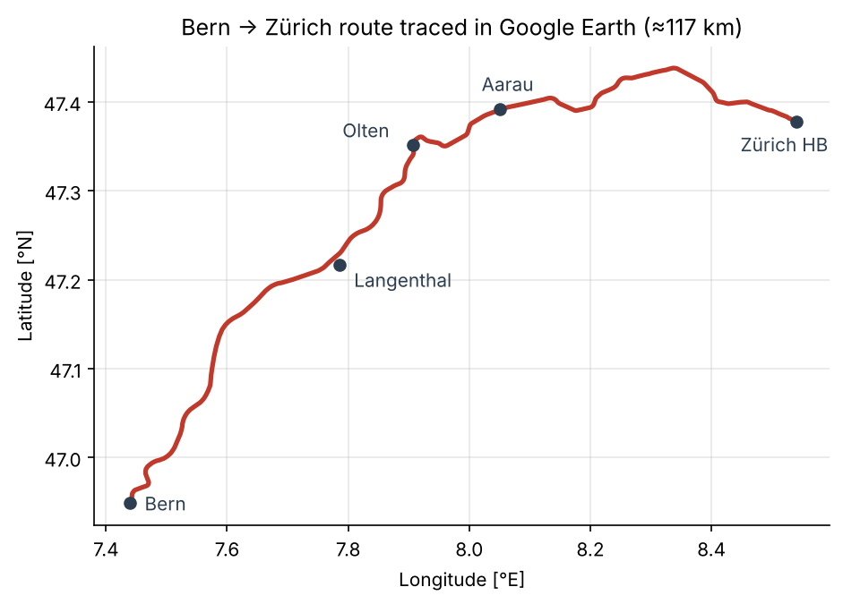
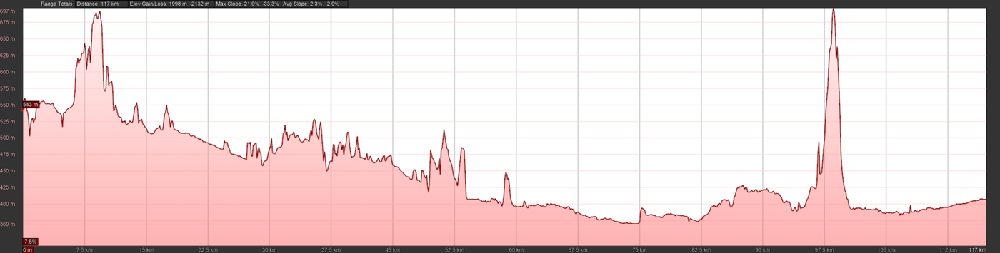
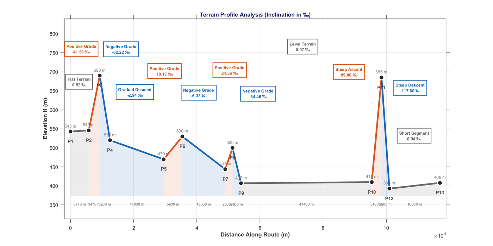
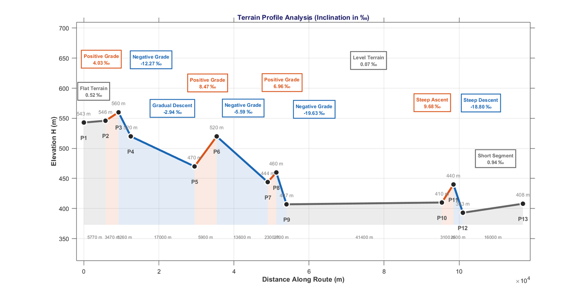
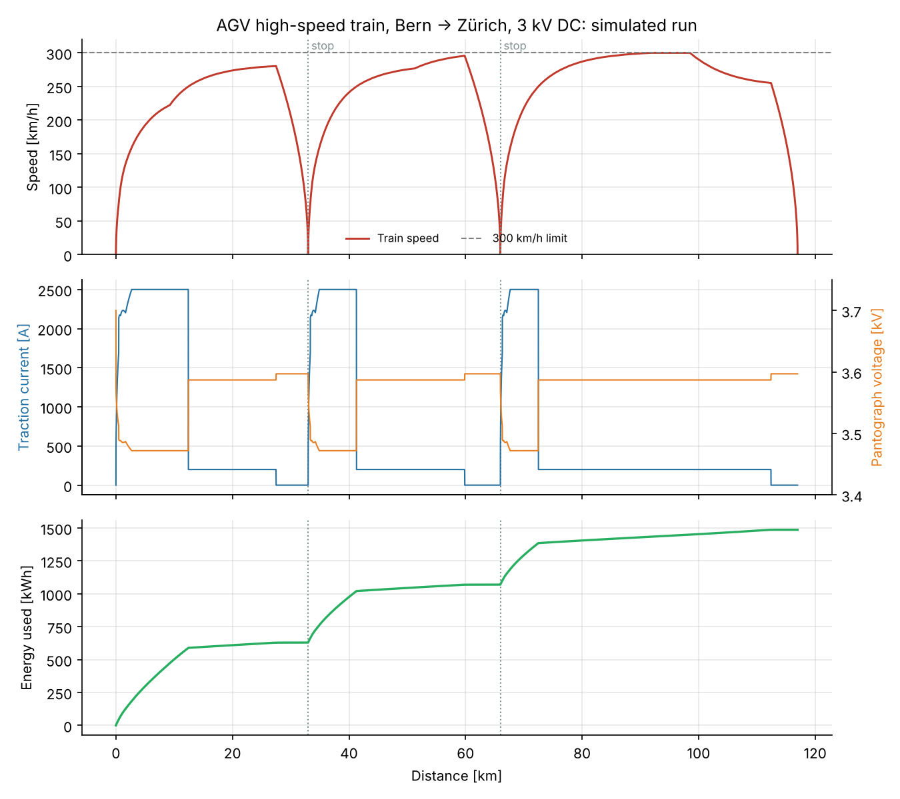

# Electric Traction: Bern → Zürich Rail Route

A real Swiss rail corridor turned into a traction simulation: I mapped the route, extracted and corrected its elevation profile so the gradients are physically possible, then ran a high-speed train over it to get speed, current, voltage and energy consumption.

Project for the **Electric Traction** course at Warsaw University of Technology (2025/26). It was a team assignment; the route mapping, profile analysis and simulation runs shown here are my work.



## At a glance

| | |
|---|---|
| Route | Bern → Langenthal → Olten → Aarau → Zürich, ≈ 117 km |
| Train | AGV high-speed trainset on 3 kV DC, 300 km/h line speed |
| Journey time | 34 min 9 s including two intermediate stops |
| Average speed | 205.6 km/h (211.8 km/h excluding stops) |
| Energy | 1487 kWh in total, **32.9 Wh per tonne-km** |

## 1. Mapping the route and its profile

I traced the line in Google Earth (the KMZ is in [`route/`](route)) and pulled the elevation profile along it.



**The problem:** Google Earth gives *surface* elevation, but the real railway goes through tunnels. Taken at face value, the profile has the train climbing and diving over hills, with gradients of **+89 ‰ and −118 ‰**. Mainline railways stay around 25 to 35 ‰ at most, so a profile like that is useless for traction calculations.



**The fix:** I split the route into 12 segments and, for each one, estimated the actual track elevation from where the tunnels start and end, instead of following the terrain. Each segment's gradient comes from `i = ΔH / ΔS` (in ‰).



| | Raw surface data | Corrected track profile |
|---|---|---|
| Steepest climb | +89.1 ‰ | **+8.5 ‰** |
| Steepest descent | −117.6 ‰ | **−19.6 ‰** |
| Usable for simulation | No | Yes |

<details>
<summary>Segment table (corrected profile)</summary>

| Segment | Start [m] | End [m] | Length [m] | Start elev. [m] | End elev. [m] | Gradient [‰] |
|---|---|---|---|---|---|---|
| 1 | 0 | 5 770 | 5 770 | 543 | 546 | +0.52 |
| 2 | 5 770 | 9 240 | 3 470 | 546 | 560 | +4.03 |
| 3 | 9 240 | 12 500 | 3 260 | 560 | 520 | −12.27 |
| 4 | 12 500 | 29 500 | 17 000 | 520 | 470 | −2.94 |
| 5 | 29 500 | 35 400 | 5 900 | 470 | 520 | +8.47 |
| 6 | 35 400 | 49 000 | 13 600 | 520 | 444 | −5.59 |
| 7 | 49 000 | 51 300 | 2 300 | 444 | 460 | +6.96 |
| 8 | 51 300 | 54 000 | 2 700 | 460 | 407 | −19.64 |
| 9 | 54 000 | 95 400 | 41 400 | 407 | 410 | +0.07 |
| 10 | 95 400 | 98 500 | 3 100 | 410 | 440 | +9.68 |
| 11 | 98 500 | 101 000 | 2 500 | 440 | 393 | −18.80 |
| 12 | 101 000 | 117 000 | 16 000 | 393 | 408 | +0.94 |

</details>

## 2. Traction simulation

The corrected profile went into a traction vehicle simulator with an AGV trainset on a 3 kV DC supply (3.7 kV no-load voltage, with line and substation resistance modelled) and two 30-second intermediate stops, at 33 km and 66 km.



What the run shows:

- **Acceleration is current-limited.** The train draws the 2500 A maximum while accelerating, then backs off to a low cruising current and coasts before braking for each stop.
- **The line voltage sags under load.** The pantograph voltage drops from 3.7 kV to about 3.47 kV during full-current acceleration because of the line and substation resistance.
- **Energy per tonne-km depends on the section.** The hilly first section costs 49.4 Wh/(t·km), while the long, flat final 51 km costs only 21.2 Wh/(t·km), where the train spends most of its time cruising.

| Section | Distance | Time | Avg speed | Energy | Unitary consumption |
|---|---|---|---|---|---|
| Bern → stop 1 | 33 km | 10 min 18 s | 192.1 km/h | 629 kWh | 49.4 Wh/(t·km) |
| Stop 1 → stop 2 | 33 km | 9 min 39 s | 205.3 km/h | 440 kWh | 34.6 Wh/(t·km) |
| Stop 2 → Zürich | 51 km | 13 min 12 s | 232.0 km/h | 417 kWh | 21.2 Wh/(t·km) |
| **Whole route** | **117 km** | **34 min 9 s** | **205.6 km/h** | **1487 kWh** | **32.9 Wh/(t·km)** |

Unitary energy consumption: `j = A / (m · S)` [Wh/(t·km)], where A is the energy drawn, m the train mass and S the distance.

I also compared speed limits (120, 200 and 300 km/h) and driving styles. *Forced* driving keeps maximum speed; *eco* driving coasts more and uses regenerative braking. Higher line speeds raise the energy per tonne-km sharply because of aerodynamic drag, and eco driving trims it further by avoiding unnecessary braking and re-acceleration.

## Repository contents

```
route/bern_zurich_route.kmz              Route traced in Google Earth (open in Google Earth)
data/simulation_bern_zurich_agv.csv      Full simulator output: time, distance, speed, force, current, voltage, energy…
images/                                  Route map, elevation profiles and simulation plots
```

## Tools

Google Earth (route and elevation), MATLAB (profile analysis and plots), a traction vehicle simulator, Python for the plots in this README.
